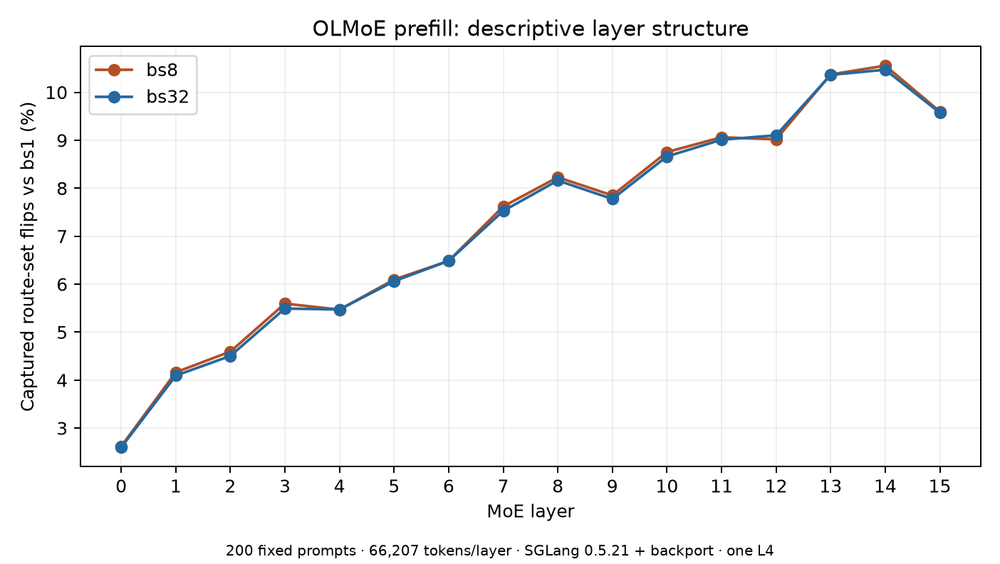

# Coin-Flip Experts

**A debugger for porting Mixture-of-Experts models to new hardware, and measurements of when their routing breaks.**

An MoE model sends every word to a few specialist sub-networks ("experts"). A small router scores all 64 experts and
picks the top 8. When expert #8 and #9 score almost the same, tiny rounding differences decide which one runs: which
chip does the math, the order numbers are added in, even how many other requests share the batch. For that word the
choice is a coin flip. I measured how often that happens, built a tool that finds which step of the math caused it,
and turned the results into requirements a chip has to meet.

## Results
- **Batch size alone changes which experts run for 7.25% of word-layers** in SGLang (OLMoE, batch 8 vs 1; 0% when the
  same run repeats). [→](findings/census-olmoe-prefill)
- **My debugger, routediff, caught and pinpointed 44/44 planted porting bugs with 0 false alarms in 32 clean runs**
  (blinded, preregistered). [→](findings/routediff-eval-real-v2)
- **It warns 3-4 bits before routing breaks:** the router's accumulator needs ≥ 18 mantissa bits (bf16's 7 flips 13% of
  routes), and routediff flags a narrowed accumulator from 21 bits down. [→](findings/accumulator-width)
- **I recovered NVIDIA NCCL's exact 4-GPU summation order from its outputs alone**, bit-exact on all 1.2M elements
  (tree: ranks 2→3→1→0; ring: start rank rotates across 8 blocks). [→](findings/nccl-validation/order-followup)
- **I ported a second model in ~15 minutes:** a Qwen3-30B-A3B MoE layer in C++, 1361/1361 routes matching PyTorch.
  routediff runs on 4 backends: my C++ port, PyTorch CPU, Apple GPU and NVIDIA L4. [→](findings/qwen3-port)



*Running the same prompts in a batch of 8 instead of 1 changes the chosen experts for 2.6% (layer 0) to 10.6% of words.*

## How routediff works
1. **Learn normal noise.** Run harmless variants (different summation order, with or without FMA) and record the largest
   difference per operation. Twice that is the tolerance.
2. **Find the suspect.** Dump every intermediate of both backends; the first operation over its tolerance is the suspect.
3. **Prove it.** Swap the reference's output into that operation and rerun. If the routes come back, it's confirmed.

```bash
make demo   # plants a router fault, localises it, proves it by patching (no GPU, no model download)
```

## What's in the repo
| | |
|---|---|
| `routediff/` | The debugger: per-op compare, calibrated tolerances, patch-forward proof, markdown report |
| `port/` | C++ MoE block with every numerics choice as a setting (precision, summation order, FMA, NEON SIMD, emulated multi-chip all-reduce), checked against PyTorch and an fp64 oracle |
| `spec/NUMERICS_CONTRACT.md` | What a chip must guarantee to keep routing stable; one measurement per line (builds on arXiv 2607.28097) |
| `findings/` | One folder per result: README, numbers, how to reproduce |
| [`RESULTS.md`](RESULTS.md) | Every result in detail, limitations and related work |

**Main limitations:** the C++ port covers the MoE block only (no attention); one model in depth (OLMoE-1B-7B, 2 layers)
plus one Qwen3 layer; the SGLang measurement is prefill only on one GPU type; multi-chip results beyond 2 GPUs are
emulation. Full list in [RESULTS.md](RESULTS.md#limitations).

## Quick start
Needs Python 3.12, CMake and a C++17 compiler.
```bash
python3 -m venv .venv && . .venv/bin/activate && python -m pip install --upgrade pip
# Linux: CPU wheel as in CI (`--index-url https://download.pytorch.org/whl/cpu`); macOS: plain PyPI
python -m pip install torch==2.14.1
python -m pip install -e ".[dev,reference,modal]"
make test   # Python + C++ tests
make demo
```
