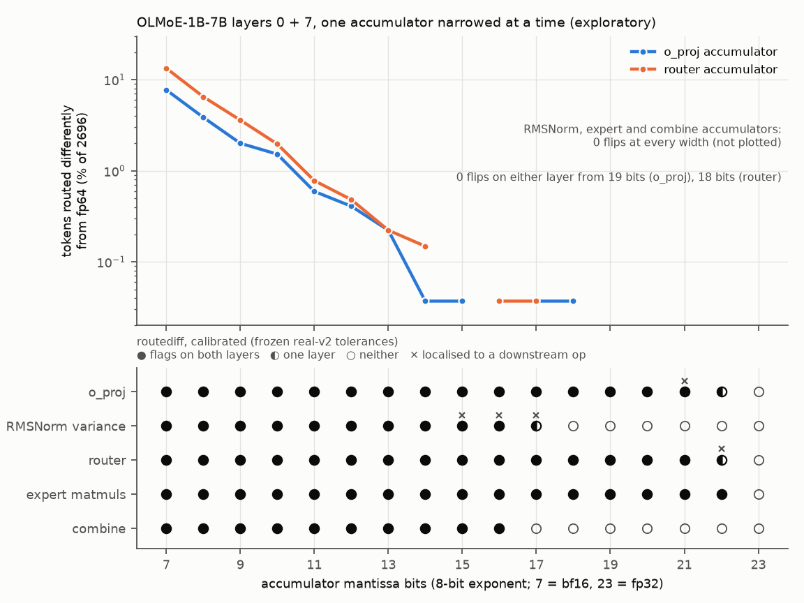

# How many accumulator bits does each op need?

**In one line:** the router's adder needs **at least 18 mantissa bits** and the router input (o_proj) **at least 19**
to change no expert choices; fp32 has 23, bf16 has 7.
- **What I found:** with bf16 accumulators the router changes the expert set of **13%** of tokens and o_proj **7.7%**;
  RMSNorm, expert and combine accumulators changed no routes at any width. routediff flags a narrowed router or
  o_proj accumulator down to **21 bits**, 3-4 bits before any route flips.
- **Why it matters:** this is a hardware requirement for the chip's accumulators, and a measured sensitivity floor
  for the debugger.
- **Caveat:** two layers of one model (1348 tokens each); a threshold is where flips stopped on these tokens, not a
  guarantee.

**Type:** exploratory (after preregistration)   ·   **Reproduce:** `python -m port.sweeps.accumulator_width --export-root data/export/olmoe-1b-7b-0924 --layers 0 7 --moe-run port/build-simd/moe_run --tolerances findings/routediff-eval-real-v2/tolerances.json --out NEW_DIR`

---

## Details

Not in PREREG; I designed and ran it after the preregistered results were in. One model (OLMoE-1B-7B), MoE blocks of
layers 0 and 7, 1348 tokens per layer.

### Route flips vs the fp64 oracle (0 flips on 1348 tokens per layer, both layers)
- **Router accumulator needs >= 18 mantissa bits** (8-bit exponent). fp32 has 23, so 5 bits of headroom; bf16 (7)
  changes the expert set of 13% of tokens.
- **o_proj accumulator (the router input) needs >= 19 mantissa bits.** bf16 changes 7.7%.
- **RMSNorm variance-sum accumulator needs >= 7 bits:** 0 flips at every width tested, down to bf16. It only sets one
  scale factor per token, and top-k is invariant to a positive scale, so it can only flip a route through rounding of
  the rescaled input, which did not happen here.
- **Expert-matmul and combine accumulators need >= 7 bits for routes:** 0 flips at every width. They run after
  selection, so they cannot change this block's routes. They do change the block output: relative L2 vs fp64
  8.5e-2 (expert) and 3.5e-3 (combine) at 7 bits. That output feeds the next layer's router; not measured here.
- **Kahan summation in a bf16 accumulator** recovers about 4 bits, not fp32: o_proj 17 flips and router 25 flips over
  both layers, about the level of a plain 11-bit accumulator (vs 208 and 360 for plain bf16).
- Flips near the threshold are isolated single tokens, and not monotone in width:
  - router: layer 0 flips 1 token at 16 bits, layer 7 1 token at 17, then 0 from 18 on both layers;
  - o_proj: 1 token on layer 7 at 14 bits and on layer 0 at 15, 17 and 18 bits, 0 from 19.
  - So a threshold means "no flips seen at this width and every wider one on these 2696 tokens", not a guarantee
    for other inputs.

### Sensitivity floor of routediff
The narrowed accumulator is a known, single-site fault, so this measures how small a fault routediff catches.

**Calibrated mode** (the frozen tolerances of the blinded evaluation, `findings/routediff-eval-real-v2/tolerances.json`,
sha256 `1944f35d…`; torch fp32 reference; evaluation split, 664 tokens per layer):

| accumulator | flags on both layers down to | flags on one layer at | correct localisation on both layers at | error at the floor (narrowed op vs torch) |
|---|---|---|---|---|
| router | 21 bits | 22 | <= 21 bits (22: localised to `router_probs`) | router_logits max 168-196 vs tolerance 122 scaled ULP; rel L2 3.0e-6 |
| o_proj | 21 bits | 22 | <= 20 bits (layer 7 at 21: `expert_act`) | o_proj_out 679 vs 502 (layer 0, 22 bits); rel L2 1.7e-6 |
| expert matmuls | 22 bits | - | correct at all 4 patch-checked widths (7, 12, 16, 20)* | expert_gate 173-189 vs 156; rel L2 1.8e-6 |
| combine | 16 bits | - | <= 16 bits | output 608-715 vs 339; rel L2 6.7e-6 |
| RMSNorm variance | 16 bits | 17 | <= 14 bits (15-17: localised to `router_logits` / `router_probs`) | router_input stays under its tolerance (239 vs 366 at 16 bits); detected through downstream ops |

\* Expert patch-forward reruns are slow (emulated matmuls), so I ran localisation at 4 widths; detection at all 17.

- **For the two accumulators that can flip routes, routediff flags the fault 3-4 bits before any route flips**:
  detection to 21 bits, first flips at <= 18 (o_proj), <= 17 (router). A port with an accumulator just narrow enough
  to start flipping routes is flagged and, in 56 of 56 cases (2 accumulators x 14 widths from 7 to 20 bits x 2 layers),
  localised to the right op.
- In relative terms the floor is a narrowed-op error of about 1.7-3e-6 relative L2. That is about 4-8x the error of a
  plain sequential fp32 accumulator (2-5e-7) and 1.1-2.1x the per-op tolerance.
- **Near the floor, localisation can land downstream:** 6 of the 11 detected cases at the floor widths (21-22 bits
  for router/o_proj, 15-17 for RMSNorm).
  - The narrowed op's own error is just under its tolerance while a later op (with a relatively tighter tolerance)
    is just over, so patch-forward first restores the later op.
  - That is consistent with "first op outside its tolerance", but it is not the injected site. **I report these as
    mislocalisations.**
  - The tolerances are calibrated per op independently; they are not mutually consistent at this scale.

**Strict mode** (no tolerances; reference = the unmodified C++ run from the same binary, so any difference is caused
by the narrowed accumulator): the first differing op is the narrowed op at every width below 23 bits, for all five
accumulators on both layers (80 / 80 per layer: 5 accumulators x 16 widths). At 23 bits, RMSNorm and combine are
bit-identical to the base, as they must be. The three matmul knobs still differ at 23 bits because the base runs them
on the NEON order and the narrowed knob is a sequential sum. Strict mode's floor is any change at all, but it needs a
same-implementation reference, which a real port does not have.

### Setup
- Script: `port/sweeps/accumulator_width.py`. Formats `e8m<m>`: 8-bit exponent, m explicit mantissa bits,
  round-to-nearest-even after every addition (e8m7 rounds like bf16 and e8m23 like fp32; tested bit-exact in
  `port/tests/test_moe.cpp`).
- One accumulator is narrowed at a time, as a sequential sum (RMSNorm keeps its torch-cascade order).
- Everything else is the `hf_fp32` preset. The matmuls that are not narrowed run on the NEON fp32 path (4
  accumulators), which is inside the benign envelope (`findings/simd`), for speed.
- Kahan rows: compensated sum in e8m7, sequential.
- Binary: frozen copy `data/results/accumulator-width-bin/moe_run` sha256 `49e9116a…`. It reproduces the scalar and
  NEON dumps of `findings/simd` 13/13 ops bit-exactly.
- Wall time: ~16 h including an overnight sleep of the laptop; one run was interrupted and resumed from `rows.jsonl`.
- Files:
  - `per_op_bits.csv`: every (accumulator, width) with flips per layer, router-logit and output relative L2 vs fp64,
    calibrated flag and localisation per layer, strict first op.
  - `summary.json`: thresholds, detection widths.
  - `flips_vs_bits.png` / `.svg`: chart from `port/sweeps/plot_accumulator_width.py`.
  - Raw parquet, per-config routediff reports and logs: `data/results/accumulator-width/` (local).

### Limitations
- Two layers of one model, 1348 tokens each; thresholds are where flips stopped on these tokens.
- One accumulator at a time; narrowing several at once compounds and is not measured.
- Formats keep fp32's 8-bit exponent; fp16-style exponents (5 bits) would add overflow and underflow effects.
- Effects on the next layer (via the block output) are not measured.
