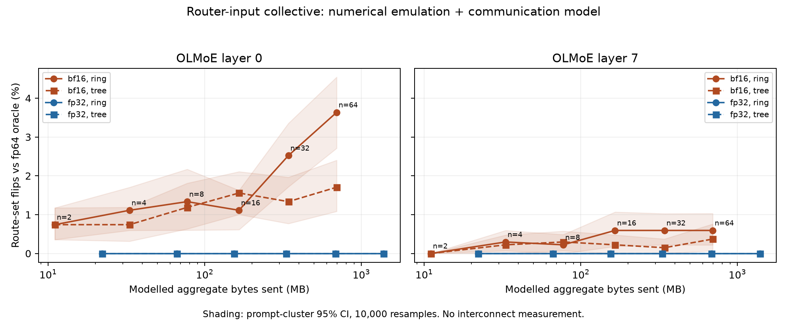

# Prompt-cluster intervals and communication model

All 100 recorded configurations (layers 0 and 7, router-input and expert-down targets, including n=1) were rechecked against saved fp64 oracle route sets. Each layer has 32 prompts and 1,348 tokens. No layers or wire dtypes are pooled.

Intervals are token-weighted flip rates from 10,000 whole-prompt bootstrap resamples (seed 20261016), 2.5th and 97.5th percentiles. The same prompt draws are reused across configurations for paired comparisons. Zero-event bootstrap intervals collapse to [0,0]; they are not population upper bounds or evidence of exact invariance. These are pointwise intervals, not simultaneous coverage over all n.



Bytes are aggregate sent bytes across all ranks for one full captured batch: payload = tokens × hidden size (router-input), or tokens × top-k × hidden size (dense expert-slot down-projection). There is no double-counting of receives. Ring reduce-scatter/all-gather and a full-buffer reduce/broadcast tree both send 2(n−1) × payload bytes in this model; tree and ring differ in sequential steps and critical-path bytes. bf16 halves bytes at fixed n. Reported timings use illustrative alpha=1 µs and bandwidth=25 GB/s, not fitted hardware parameters. The numerical emulation models sequential/ring or pairwise/tree rounding, not a measured implementation of either communication algorithm. Padding, sparse dispatch, contention and overlap are omitted.

The chart covers router-input route flips. Expert-down collectives cannot affect routes in this block; all their route-flip intervals are zero and remain in the CSV. Their output error is reported separately in the parent findings.

## Router-input flip rates (%, 95% prompt-cluster CI)

| Layer | n | Wire | Topology | Flips / tokens | Rate [95% CI] |
| --- | --- | --- | --- | --- | --- |
| 0 | 1 | none | none | 0/1348 | 0.000 [0.000, 0.000] |
| 0 | 2 | bf16 | ring | 10/1348 | 0.742 [0.357, 1.176] |
| 0 | 2 | fp32 | ring | 0/1348 | 0.000 [0.000, 0.000] |
| 0 | 2 | bf16 | tree | 10/1348 | 0.742 [0.357, 1.176] |
| 0 | 2 | fp32 | tree | 0/1348 | 0.000 [0.000, 0.000] |
| 0 | 4 | bf16 | ring | 15/1348 | 1.113 [0.595, 1.705] |
| 0 | 4 | fp32 | ring | 0/1348 | 0.000 [0.000, 0.000] |
| 0 | 4 | bf16 | tree | 10/1348 | 0.742 [0.315, 1.190] |
| 0 | 4 | fp32 | tree | 0/1348 | 0.000 [0.000, 0.000] |
| 0 | 8 | bf16 | ring | 18/1348 | 1.335 [0.600, 2.170] |
| 0 | 8 | fp32 | ring | 0/1348 | 0.000 [0.000, 0.000] |
| 0 | 8 | bf16 | tree | 16/1348 | 1.187 [0.633, 1.811] |
| 0 | 8 | fp32 | tree | 0/1348 | 0.000 [0.000, 0.000] |
| 0 | 16 | bf16 | ring | 15/1348 | 1.113 [0.612, 1.627] |
| 0 | 16 | fp32 | ring | 0/1348 | 0.000 [0.000, 0.000] |
| 0 | 16 | bf16 | tree | 21/1348 | 1.558 [1.005, 2.108] |
| 0 | 16 | fp32 | tree | 0/1348 | 0.000 [0.000, 0.000] |
| 0 | 32 | bf16 | ring | 34/1348 | 2.522 [1.716, 3.353] |
| 0 | 32 | fp32 | ring | 0/1348 | 0.000 [0.000, 0.000] |
| 0 | 32 | bf16 | tree | 18/1348 | 1.335 [0.770, 1.964] |
| 0 | 32 | fp32 | tree | 0/1348 | 0.000 [0.000, 0.000] |
| 0 | 64 | bf16 | ring | 49/1348 | 3.635 [2.711, 4.545] |
| 0 | 64 | fp32 | ring | 0/1348 | 0.000 [0.000, 0.000] |
| 0 | 64 | bf16 | tree | 23/1348 | 1.706 [1.085, 2.402] |
| 0 | 64 | fp32 | tree | 0/1348 | 0.000 [0.000, 0.000] |
| 7 | 1 | none | none | 0/1348 | 0.000 [0.000, 0.000] |
| 7 | 2 | bf16 | ring | 0/1348 | 0.000 [0.000, 0.000] |
| 7 | 2 | fp32 | ring | 0/1348 | 0.000 [0.000, 0.000] |
| 7 | 2 | bf16 | tree | 0/1348 | 0.000 [0.000, 0.000] |
| 7 | 2 | fp32 | tree | 0/1348 | 0.000 [0.000, 0.000] |
| 7 | 4 | bf16 | ring | 4/1348 | 0.297 [0.070, 0.594] |
| 7 | 4 | fp32 | ring | 0/1348 | 0.000 [0.000, 0.000] |
| 7 | 4 | bf16 | tree | 3/1348 | 0.223 [0.000, 0.475] |
| 7 | 4 | fp32 | tree | 0/1348 | 0.000 [0.000, 0.000] |
| 7 | 8 | bf16 | ring | 3/1348 | 0.223 [0.000, 0.487] |
| 7 | 8 | fp32 | ring | 0/1348 | 0.000 [0.000, 0.000] |
| 7 | 8 | bf16 | tree | 4/1348 | 0.297 [0.071, 0.576] |
| 7 | 8 | fp32 | tree | 0/1348 | 0.000 [0.000, 0.000] |
| 7 | 16 | bf16 | ring | 8/1348 | 0.593 [0.182, 1.069] |
| 7 | 16 | fp32 | ring | 0/1348 | 0.000 [0.000, 0.000] |
| 7 | 16 | bf16 | tree | 3/1348 | 0.223 [0.000, 0.477] |
| 7 | 16 | fp32 | tree | 0/1348 | 0.000 [0.000, 0.000] |
| 7 | 32 | bf16 | ring | 8/1348 | 0.593 [0.223, 1.026] |
| 7 | 32 | fp32 | ring | 0/1348 | 0.000 [0.000, 0.000] |
| 7 | 32 | bf16 | tree | 2/1348 | 0.148 [0.000, 0.373] |
| 7 | 32 | fp32 | tree | 0/1348 | 0.000 [0.000, 0.000] |
| 7 | 64 | bf16 | ring | 8/1348 | 0.593 [0.219, 1.031] |
| 7 | 64 | fp32 | ring | 0/1348 | 0.000 [0.000, 0.000] |
| 7 | 64 | bf16 | tree | 5/1348 | 0.371 [0.072, 0.760] |
| 7 | 64 | fp32 | tree | 0/1348 | 0.000 [0.000, 0.000] |

## Reproduce

Install the `analysis` extra, then use a new output path:

```sh
python -m analysis.h4 --source data/results/h4-collective-sweep-fp32 --out NEW_OUTPUT_DIRECTORY
```

`h4_intervals.csv` contains every configuration plus modelled aggregate/critical-path bytes and steps; `h4_intervals.provenance.json` records input hashes and bootstrap/model settings. The parquet copy is retained locally under the repository ignore rule.
